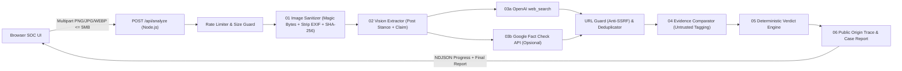

# ARCHITECTURE — KLAIMSCAN AI

Dokumen ini menjelaskan arsitektur full-stack, alur pemrosesan 6 tahap, isolasi data tidak tepercaya (*prompt-injection & SSRF defense*), serta batasan privasi pada **KLAIMSCAN AI**.

---

## 1. Gambaran Umum Sistem

Aplikasi berjalan sebagai **monolit full-stack Next.js App Router** sehingga API key (`OPENAI_API_KEY`, `FACTCHECK_API_KEY`) tidak pernah keluar dari runtime Node.js server.

---

## 2. Pemisahan Tanggung Jawab Pipeline (6 Tahap)

### 01 — Image Processing (`src/lib/image/sanitize.ts`)
- Menolak file melebihi `5 * 1024 * 1024` bytes (`MAX_IMAGE_BYTES`) di browser maupun server.
- Memeriksa **magic bytes** asli untuk PNG (`89 50 4E 47`), JPEG (`FF D8 FF`), dan WebP (`RIFF....WEBP`) sebelum diproses.
- Menghapus segmen metadata berisiko privasi di memori:
  - PNG: menghapus segmen `eXIf`, `tEXt`, `zTXt`, `iTXt`, `pHYs`, `tIME`.
  - JPEG: menghapus `APP1` (EXIF/XMP) s.d. `APP15` dan komentar `COM`.
  - WebP: menghapus chunk `EXIF`/`XMP ` serta mereset bit flag terkait pada header `VP8X`.
- Menghitung **SHA-256** dari gambar bersih. Tidak ada penyimpanan disk atau object storage permanen (`persistedOnServer: false`).

### 02 — Vision Claim Extraction (`src/lib/pipeline/claim-extractor.ts`)
- Menggunakan `client.responses.parse` dengan skema **Zod** ketat (`ClaimExtractionZodSchema`) terhadap model dari `OPENAI_VISION_MODEL`.
- Mengekstrak **klaim faktual** (`primaryClaim`, `secondaryClaims`) sekaligus memisahkan **5 kategori sikap postingan (`postStance`)**:
  - `asserting_claim`
  - `debunking_claim` (contoh akun `@vereditum` yang sedang membantah hoaks)
  - `quoting_claim`
  - `neutral_discussion`
  - `unclear_context`
- URL yang terbaca pada screenshot dilewatkan ke `normalizeVisiblePostUrl` → `sanitizePublicEvidenceUrl` untuk mencegah skema berbahaya (`javascript:`, `file:`) atau host privat masuk ke laporan.

### 03 — Live Evidence Retrieval (`src/lib/pipeline/evidence-retriever.ts`)
- Menjalankan pencarian paralel (`Promise.allSettled`):
  1. **Google Fact Check Tools API** (jika `FACTCHECK_API_KEY` tersedia; timeout 8 detik).
  2. **OpenAI Responses API `web_search`** (timeout 25 detik; menggunakan `include: ["web_search_call.action.sources"]` serta `url_citation`).
- Mengklasifikasikan tingkat otoritas domain (`official_government`, `fact_checker`, `credible_media`, `public_source`).
- Melakukan deduplikasi berbasis URL yang telah dibersihkan parameter pelacakan (`utm_*`, `fbclid`, `gclid`, `igsh`) dan difilter oleh `url-guard.ts`.

### 04 — Evidence Comparison (`src/lib/pipeline/evidence-comparator.ts`)
- Mengevaluasi tiap kandidat terhadap `primaryClaim` saja (terpisah dari `postStance`), mengklasifikasikan relasi ke `supporting`, `contradicting`, `partial_context`, atau `irrelevant`.
- **Anti-halusinasi ID**: hasil evaluasi model disaring dengan `candidateIds` sehingga LLM tidak pernah dapat menyuntikkan URL fiktif atau memalsukan sitasi.
- Mengakomodasi sinyal waktu kedaluwarsa (`mentionsOutdatedContext`) dan fallback otomatis ke `textualRating` dari Google Fact Check API apabila evaluasi LLM mengalami gangguan/timeout.

### 05 — Deterministic Verdict Engine (`src/lib/pipeline/verdict-engine.ts`)
- Menghitung status akhir (`FALSE`, `TRUE`, `MISLEADING`, `OUTDATED`, `UNVERIFIED`) berdasarkan bobot sumber terverifikasi:
  - `official_government`: `3.0`
  - `fact_checker`: `2.5`
  - `credible_media`: `1.5`
  - `public_source`: `1.0`
- **Tanpa angka confidence buatan**: engine tidak mengeluarkan nilai probabilitas acak dari LLM.
- **Aturan default aman**: bila klaim tidak dapat diuji atau tidak ada bukti resmi/kredibel yang memadai (termasuk hanya 1 `public_source` tanpa konfirmasi), verdict ditetapkan `UNVERIFIED`.
- Menyimpan `postClassification` secara terpisah agar postingan pembantah (*debunking*) tidak disalahkan sebagai pencipta disinformasi.

### 06 — Public Origin Trace & Report Generator (`src/lib/pipeline/public-trace.ts`, `report-generator.ts`)
- Menyusun kronologi peristiwa publik dari indikator screenshot + tanggal bukti terindeks + timestamp verifikasi server.
- Memisahkan bukti pendukung (`supportingEvidence`), bukti pembantah (`contradictingEvidence`), dan bukti konteks parsial (`partialContextEvidence`).
- Menyematkan `privacyGuarantee`, `attributionCaveat`, dan `STANDARD_REPORT_LIMITATIONS` ke setiap laporan agar siap dicetak ke PDF melalui media stylesheet (`@media print` pada `src/app/globals.css`).

---

## 3. Kontrol Keamanan (Defense-in-Depth)

| Ancaman | Kontrol Implementasi | Lokasi |
| --- | --- | --- |
| Kebocoran API key ke client | Resolusi env khusus server; `/api/health` hanya mengembalikan boolean status; redaksi token `sk-`/`AIza` pada pesan error | `src/lib/env.ts`, `src/lib/security/error-sanitizer.ts` |
| Prompt injection di screenshot / halaman web | Pembatasan panjang + pembersihan karakter kontrol/tag XML (`sanitizeUntrustedText`), isolasi tag `<untrusted_analyst_notes>` dan `<untrusted_web_evidence>`, serta validasi Zod ketat | `src/lib/pipeline/claim-extractor.ts`, `src/lib/pipeline/evidence-comparator.ts` |
| SSRF / URL internal berbahaya | Pemblokiran `localhost`, IPv4 privat/link-local (`127.0.0.0/8`, `10.0.0.0/8`, `169.254.169.254`, `172.16.0.0/12`, `192.168.0.0/16`, `100.64.0.0/10`), IPv6 lokal (`::1`, `fc/fd`, `fe80`), `.local`, `.internal`, kredensial tersisip, serta skema non-HTTP(S) | `src/lib/security/url-guard.ts` |
| Upload berbahaya / payload besar | Penolakan payload multipart berlebih, pembatasan file 5 MB, verifikasi magic-bytes, dan zero disk persistence | `src/lib/image/sanitize.ts`, `src/app/api/analyze/route.ts` |
| Abuse / DoS API berbiaya | Sliding-window per-IP rate limiter (15 permintaan/menit per IP) dengan header `Retry-After` dan batas timeout pada setiap panggilan eksternal | `src/lib/security/rate-limit.ts`, `src/app/api/analyze/route.ts` |
| Hardening respons HTTP | Header keamanan `X-Content-Type-Options: nosniff`, `X-Frame-Options: DENY`, `Referrer-Policy`, dan `Permissions-Policy` | `next.config.ts` |
