# ARCHITECTURE — KLAIMSCAN AI

Dokumen ini menjelaskan arsitektur full-stack, alur pemrosesan 6 tahap, batas kepercayaan (*trust boundaries*), serta kontrol keamanan & privasi pada **KLAIMSCAN AI**.

---

## 1. Gambaran Umum Sistem

Aplikasi berjalan sebagai **monolit full-stack Next.js App Router** sehingga API key (`OPENAI_API_KEY`, `FACTCHECK_API_KEY`, `UPSTASH_REDIS_REST_TOKEN`) tidak pernah keluar dari runtime Node.js server.

```mermaid
flowchart LR
    U["Browser SOC UI (+ Interactive OCR Highlight)"] -->|"Multipart PNG/JPG/WEBP <= 4MB (< 4.5MB Vercel Cap)"| API["POST /api/analyze (Node.js)"]
    API --> RL["Access Gate, Trusted IP & Atomic Lua Distributed Rate/Credit Guard"]
    RL --> S1["01 Image Sanitizer + Server OCR Ruler (Magic Bytes + Strip EXIF + SHA-256)"]
    S1 --> S2A["02A Vision OCR Only (Headline, Overlay, Caption, Coords)"]
    S2A --> S2B["02B Text-Only Claim Normalizer (Zero Image Input)"]
    S2B --> S3A["03a OpenAI web_search"]
    S2B --> S3B["03b Google Fact Check API (Opsional)"]
    S3A --> UG["URL Guard (Anti-SSRF), Strict Domain Trust & Deduplicator"]
    S3B --> UG
    UG --> S4["04 Evidence Comparator (Text Proposition + Temporal + Visual Exclusion)"]
    S4 --> S5["05 Deterministic Verdict Engine (Text-First Corroboration)"]
    S5 --> S6["06 Public Origin Trace & Case Report"]
    S6 -->|"NDJSON Progress + Final Report"| U
```

---

## 2. Pemisahan Tanggung Jawab Pipeline (6 Tahap Text-First & Batas Waktu Menyeluruh)

Seluruh eksekusi dikawal oleh *root deadline controller* (`ANALYZE_PIPELINE_DEADLINE_MS`, default `48.000 ms` di bawah `maxDuration = 60` Vercel) yang mewariskan sisa anggaran waktu dan `AbortSignal` ke tiap tahap.

### 01 — Image Processing & Server-Side OCR Guide (`src/lib/image/sanitize.ts`, `ocr-guide.ts`)
- Menolak file melebihi `4 * 1024 * 1024` bytes (`4 MB` / `MAX_IMAGE_BYTES`) serta payload multipart `> 4.450.000` bytes agar kompatibel penuh dengan batas request body **4,5 MB Vercel**.
- Memeriksa **magic bytes** asli untuk PNG (`89 50 4E 47`), JPEG (`FF D8 FF`), dan WebP (`RIFF....WEBP`) sebelum diproses.
- Menghapus segmen metadata berisiko privasi di memori (`eXIf`, `tEXt`, `APP1`, `VP8X` EXIF/XMP).
- Menghitung **SHA-256** dari gambar bersih tanpa penyimpanan permanen (`persistedOnServer: false`), lalu merender panduan penggaris koordinat OCR secara eksklusif di server menggunakan `sharp` dengan verifikasi kecocokan SHA-256 (input `ocrGuide` dari klien diabaikan).

### 02 — Text-First Two-Stage OCR & Claim Extraction (`src/lib/pipeline/claim-extractor.ts`)
- **Stage A (`extractOcrFromScreenshot` — Vision OCR ONLY)**: satu-satunya tahap yang menerima `base64DataUrl`. Membaca teks terlihat termasuk **teks/headline besar yang menempel DI ATAS foto sampul**, `extractedHeadline`, `graphicOverlayTexts`, `extractedCaption` (`captionTruncated`), publisher/handle publik, tanggal unggahan, catatan klarifikasi, serta koordinat kotak teks `ocrRegions` (0–1000) untuk *OCR Text Highlight* interaktif. Dilarang menilai wajah tokoh, seragam, latar, atau keaslian foto sampul.
- **Stage B (`extractClaimsFromOcrText` — Text-Only Normalization)**: hanya menerima JSON teks hasil OCR (**nol input gambar**). Menghasilkan `normalizedClaims` terstruktur (`subject`, `predicateAction`, `objectTarget`, `eventDate`, `legalOrAdministrativeStatus`) serta `atomicClaims` berbasis teks (`main_event`, `formal_legal_status`, `time_and_location`, `person_and_role`, `caption_context`) tanpa `media_authenticity`. Menjaga perbedaan semantik antara headline dan caption (mis. `"resmi ajukan pengunduran diri"` vs `"menyampaikan niat mengundurkan diri"`). Apabila OCR tidak memuat teks faktual terbaca (`hasReadableFactualText === false`), pipeline langsung menetapkan `UNVERIFIED` tanpa menebak.
- Memisahkan **proposisi klaim faktual (`primaryClaim`)** dari **5 kategori sikap postingan (`postStance`)**: `asserting_claim`, `debunking_claim`, `quoting_claim`, `neutral_discussion`, dan `unclear_context`.
- URL yang terbaca pada screenshot dilewatkan ke `normalizeVisiblePostUrl` → `sanitizePublicEvidenceUrl`.

### 03 — Live Evidence Retrieval & Strict Source Trust (`src/lib/pipeline/evidence-retriever.ts`)
- Menjalankan pencarian paralel seimbang (`Promise.allSettled`):
  1. **Google Fact Check Tools API** (`timeout <= 8s`).
  2. **OpenAI Responses API `web_search`** (`timeout <= 25s`), mengekstrak kutipan bersentuhan batas kalimat lengkap (*sentence-aware excerpt*) agar konteks berita maupun bantahan tidak terpotong di tengah kata.
- **Pencocokan Otoritas Domain Ketat (`classifySourceTier`)**:
  - Menggunakan hostname tervalidasi dari URL tujuan (`normalizeHostname`) dengan pencocokan eksak atau subdomain valid (`matchesTrustedDomain`), menolak *embedded substring*, *punycode* IDN (`xn--`), *userinfo* `@`, maupun path seperti `/hoaks` pada domain sembarang.
  - Subdomain UGC (`forum.`, `blog.`, `community.`) di portal berita tetap diturunkan menjadi `public_source`.
  - Jalur `/cek-fakta` hanya elevating ke `fact_checker` apabila berada pada hostname media terkurasi.

### 04 — Evidence Comparison (`src/lib/pipeline/evidence-comparator.ts`)
- Mengevaluasi tiap kandidat terhadap proposisi tekstual yang sesuai (`evaluatedAtomicClaimId` + `targetAspect`: `event_occurrence`, `official_legal_status`, `text_claim`, serta penanda eksklusi `image_authenticity`).
- **Verifikasi Temporal Deterministik (`temporalStatus`)**: mengekstrak tanggal artikel dari teks/URL (`20261110...`, ISO, DD Bulan YYYY) dan mendiskualifikasi klarifikasi lama (`historical_debunk`) agar debunk kejadian lampau (mis. 12 Oktober 2026 atas video 2024) tidak pernah membantah perkembangan tanggal baru (mis. 10 November 2026).
- **Eksklusi Klarifikasi Foto Sampul**: klarifikasi yang semata-mata menguji keaslian foto/visual sampul (`image_authenticity` / `isVisualAuthenticityCandidate`) dipetakan sebagai `relation = "irrelevant"` dengan alasan transparan sehingga foto ilustrasi palsu tidak pernah membatalkan peristiwa berita tekstual yang memang terjadi.
- Halaman hasil penelusuran mentah tanpa kutipan isi artikel (`isQueryPlaceholderSnippet`) serta evaluasi `irrelevant` tidak pernah memengaruhi verdict maupun `outdatedSignalDetected`.
- Jika sisa waktu pipeline `< 3s` sebelum batas `48s`, komparator melakukan degradasi aman ke *deterministic fallback* tervalidasi proposisi, waktu, & aspek (`doesCandidateMatchProposition`).

### 05 — Deterministic Text-First Verdict Engine (`src/lib/pipeline/verdict-engine.ts`)
- Mengecualikan seluruh sumber berstatus `irrelevant` maupun `image_authenticity`.
- Menghasilkan **Atomic Assessments & Qualified Status Labels** murni berbasis teks (`EVENT CONFIRMED`, `OFFICIAL STATUS CONFIRMED`, `INTENTION CONFIRMED`, `FORMAL STATUS UNVERIFIED`) tanpa label keaslian foto (`VIRAL PHOTO FALSE` dihapus). Bila niat/peristiwa utama terkonfirmasi (`TRUE`) tetapi langkah hukum/formal wajib belum terverifikasi (`UNVERIFIED`), verdict utama dijaga tetap `UNVERIFIED`.
- **Koroborasi Per Penerbit Independen (`deduplicateByPublisher`)**: mengelompokkan sumber berdasarkan root domain registrable (`korlantas.polri.go.id` & `humas.polri.go.id` → `polri.go.id`; `nasional.kompas.com` & `www.kompas.com` → `kompas.com`) sehingga beberapa artikel dari satu penerbit hanya dihitung satu kali.
- Menetapkan verdict (`FALSE`, `TRUE`, `MISLEADING`, `OUTDATED`, `UNVERIFIED`) berbasis bobot penerbit independen tanpa angka persentase confidence buatan LLM.
- Satu sumber `public_source` atau beberapa artikel dari satu penerbit media saja tanpa otoritas resmi/`fact_checker` otomatis dijaga tetap `UNVERIFIED`.
- Satu sumber pembantah terisolasi tidak mengesampingkan mayoritas bukti `partial_context` kredibel menjadi `FALSE`.

### 06 — Public Origin Trace & Report Generator (`src/lib/pipeline/public-trace.ts`, `report-generator.ts`)
- Menyusun kronologi peristiwa publik, memisahkan bukti mendukung/membantah/konteks parsial, dan menanamkan jaminan privasi serta batasan metodologi.

---

## 3. Kontrol Keamanan (Defense-in-Depth)

| Ancaman | Kontrol Implementasi | Lokasi |
| --- | --- | --- |
| Kebocoran API key / exception mentah | Resolusi env khusus server; error client generik dengan `errorId`; redaksi token `sk-`/`AIza`/`Bearer` di log server | `src/lib/env.ts`, `src/lib/security/error-sanitizer.ts` |
| Spoofing kepercayaan sumber | Pencocokan hostname ketat exact/subdomain, daftar `TRUSTED_FACT_CHECK_DOMAINS` & `CURATED_CREDIBLE_MEDIA_DOMAINS`, penolakan path `/hoaks` pada domain sembarang | `src/lib/pipeline/evidence-retriever.ts` |
| Salah klasifikasi rating fact-check tidak relevan | Guard `addressesSameProposition`, `matchesTimeContext`, `doesCandidateMatchProposition`, dan urutan prioritas negasi sebelum kata afirmatif | `src/lib/pipeline/evidence-comparator.ts` |
| Inflasi bukti oleh penerbit tunggal | Deduplikasi per root publisher sebelum pembobotan verdict | `src/lib/pipeline/verdict-engine.ts` |
| IP Header Spoofing & Abuse API berbayar | Trusted proxy mode (`none`/`vercel`/`cloudflare`/`forwarded-rightmost`), dukungan Upstash Redis REST terdistribusi, batas kuota AI global per jam, semaphore konkurensi, saklar akses/token opsional | `src/lib/security/rate-limit.ts`, `src/app/api/analyze/route.ts` |
| SSRF / URL internal berbahaya | Pemblokiran `localhost`, IPv4/IPv6 privat/link-local, userinfo `@`, non-HTTP(S), serta penghapusan `utm_*`/`fbclid` | `src/lib/security/url-guard.ts` |
| Upload berbahaya / payload besar | Pembatasan **4 MB** (< `4,5 MB` batas request Vercel) konsisten di UI & server, generator penggaris OCR *server-side* terkunci SHA-256, verifikasi magic-bytes, dan zero disk persistence | `src/lib/image/sanitize.ts`, `ocr-guide.ts`, `src/app/api/analyze/route.ts` |
| Pipeline menggantung melewati batas `60s` | Batas eksekusi menyeluruh `48s` (`ANALYZE_PIPELINE_DEADLINE_MS`) + degradasi aman ke fallback | `src/lib/pipeline/orchestrator.ts` |
