# KLAIMSCAN AI

KLAIMSCAN membaca klaim yang tertulis pada screenshot unggahan, lalu membandingkannya dengan sumber terbuka. Hasilnya satu berkas pemeriksaan: teks yang terbaca, klaim yang diuji, sumber yang mendukung atau membantah, dan satu bacaan.

Bacaan itu bukan putusan hukum dan bukan skor kepercayaan. Klaim yang belum cukup bukti tetap **butuh verifikasi**. Akun yang sedang membantah hoaks tidak dilabeli sebagai pembuat hoaks.

Situs produksi: [klaimscan.vercel.app](https://klaimscan.vercel.app).

Dibangun untuk **Kartika Cyber Hackathon 2026 — Kategori Siber Sosial**.

## Cara website ini bekerja

Satu pemeriksaan mengikuti enam tahap. Gambar hanya dipakai untuk membaca teks. Kebenaran dinilai dari proposisi yang tertulis, bukan dari wajah, seragam, atau foto sampul.

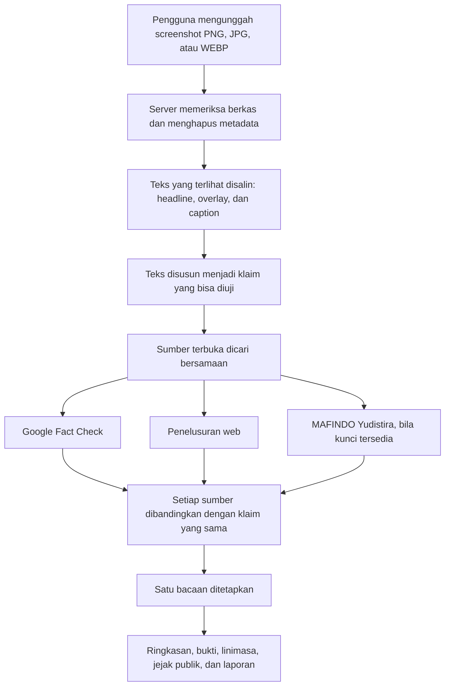

Lima bacaan yang mungkin keluar:

| Bacaan | Arti |
| --- | --- |
| Hoaks | Sumber yang selaras membantah klaim yang tertulis. |
| Valid | Sumber yang selaras mendukung klaim yang tertulis. |
| Menyesatkan | Ada bagian yang benar, tetapi konteks atau cakupannya menyesatkan. |
| Kedaluwarsa | Peristiwa atau klarifikasi itu milik waktu yang sudah lewat. |
| Butuh verifikasi | Teks belum cukup jelas, atau bukti yang terindeks belum cukup. |

Status angka pada arsip MAFINDO tidak diubah menjadi salah satu bacaan di atas. Arsip itu membantu menemukan pemeriksaan yang sudah ada. Google Fact Check dan penelusuran web tetap berjalan bila kunci MAFINDO belum diisi.

## Tampilan

### Beranda

Beranda menjelaskan apa yang diperiksa dan empat langkah dari unggah sampai bacaan.

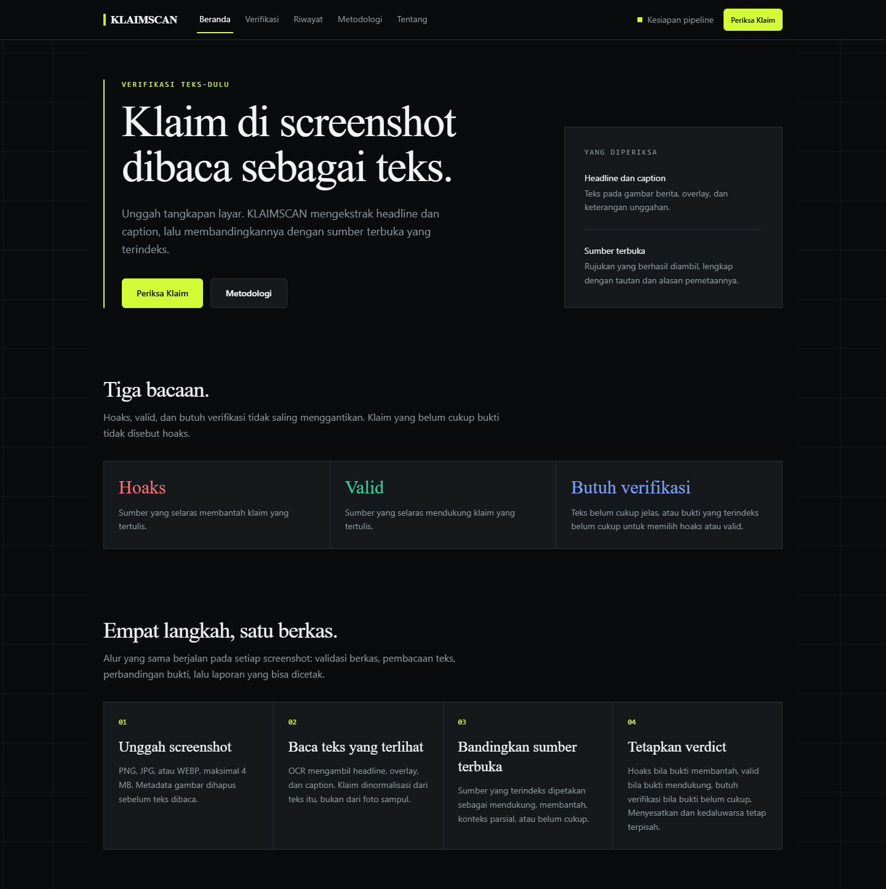

### Periksa klaim

Di sini screenshot diunggah. Berkas yang diterima PNG, JPG, atau WEBP, paling besar 4 MB. Metadata gambar dihapus sebelum teks dibaca, dan berkas tidak disimpan permanen di server.

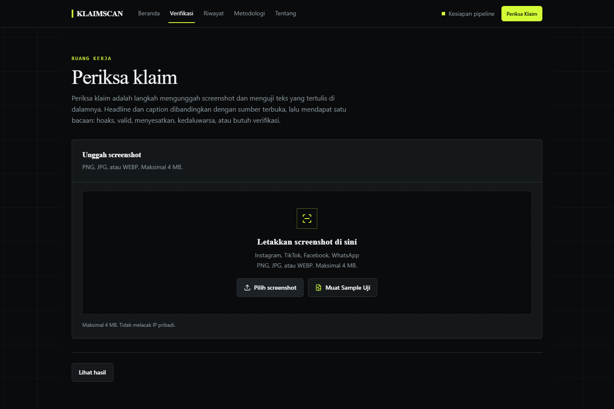

### Hasil pemeriksaan

Hasil menampilkan satu kasus. Pemilih di atas berpindah antar kasus contoh. Daftar lengkap ada di Riwayat.

Lima bagian hasil:

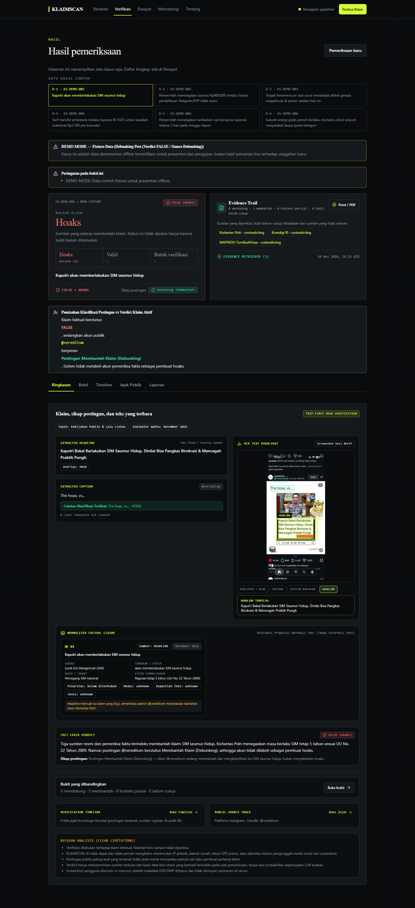

**Bukti** memisahkan sumber yang mendukung, membantah, memberi konteks parsial, dan yang belum cukup.

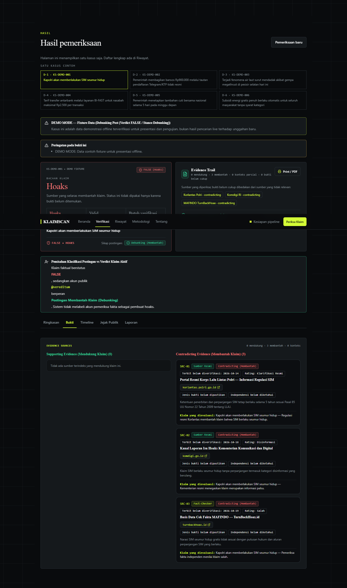

**Timeline** menyusun jejak waktu pemeriksaan.

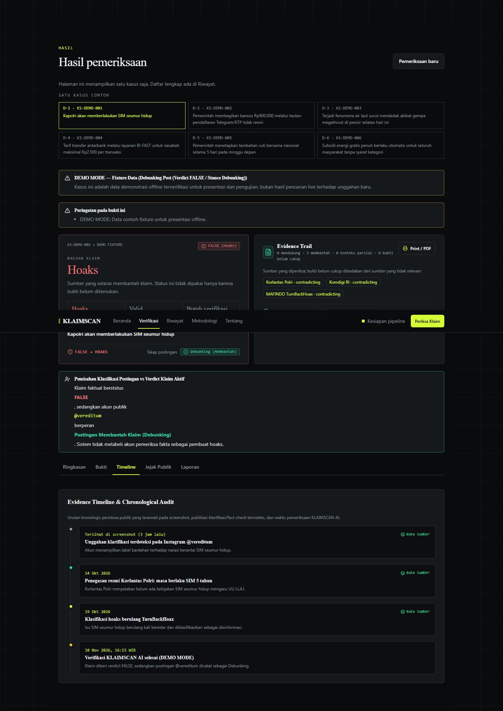

**Jejak publik** menampilkan platform dan akun yang terlihat pada screenshot, plus batasan yang tidak dilakukan: tidak ada pelacakan IP, alamat, atau identitas hukum.

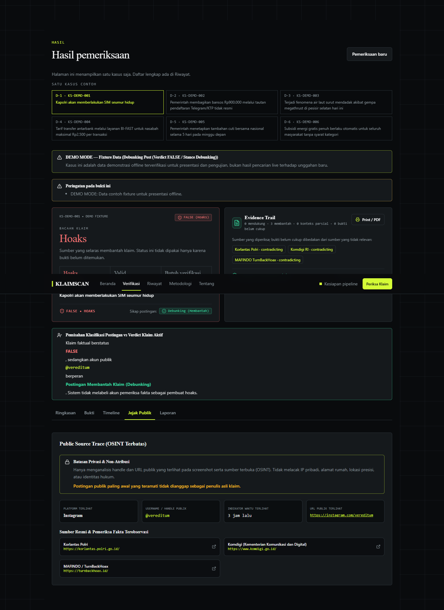

**Laporan** adalah berkas yang bisa dicetak atau disimpan sebagai PDF.

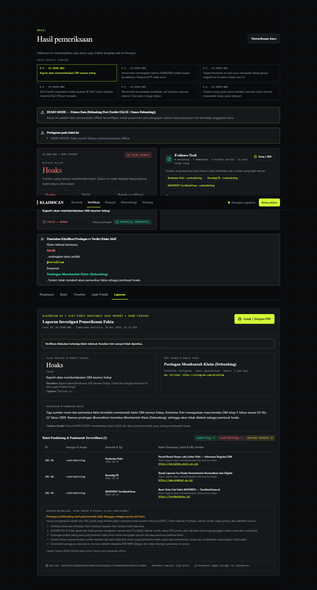

### Riwayat kasus

Riwayat adalah daftar seluruh pemeriksaan pada sesi browser ini, termasuk fixture contoh. Satu baris membuka satu hasil. Tabel di bawahnya mengumpulkan tautan sumber dari kasus yang sedang dimuat, bukan metrik platform.

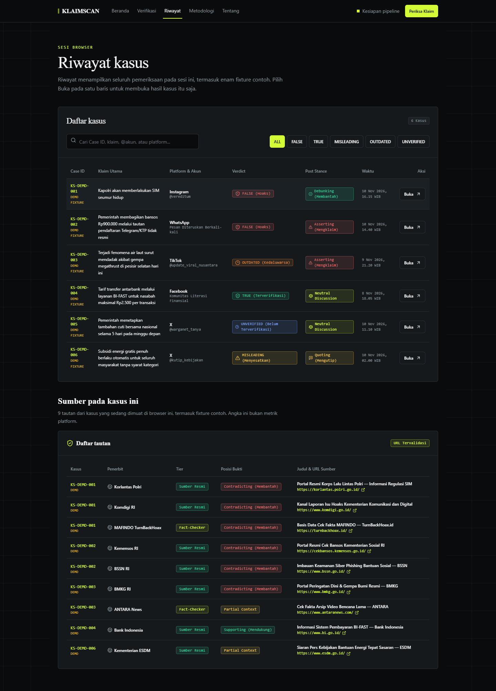

### Metodologi

Metodologi menjelaskan enam tahap yang sama dengan diagram di atas, beserta arti tiap bacaan.

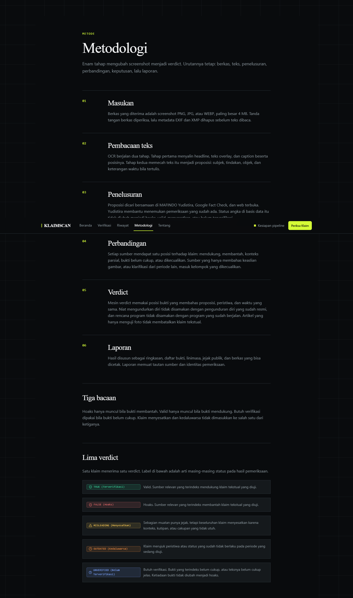

### Tentang

Tentang merangkum apa yang dihasilkan dan apa yang tidak diklaim oleh pemeriksaan ini.

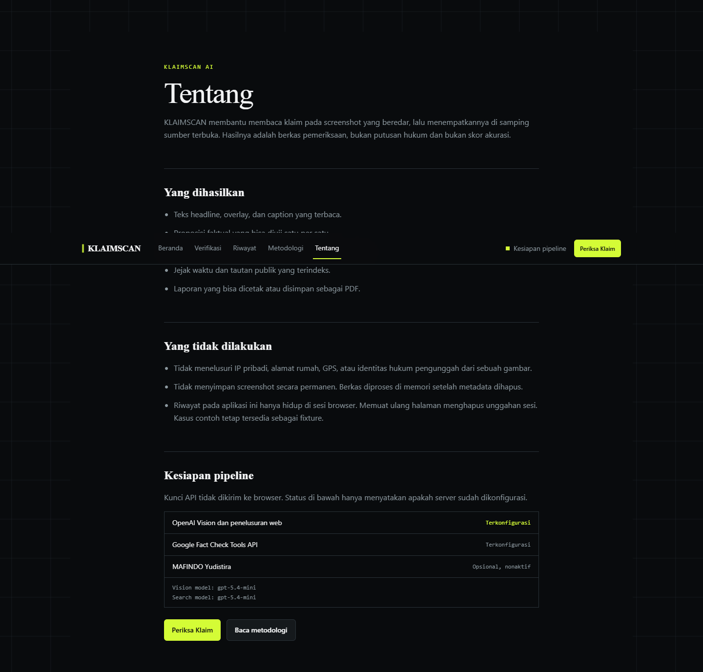

## Yang diperiksa

1. **Berkas.** Magic bytes diperiksa, metadata EXIF/XMP dihapus di memori, dan hash SHA-256 dihitung. Gambar pengguna tidak disimpan permanen.
2. **Teks.** Tahap pertama menyalin headline, overlay, caption, dan posisinya. Tahap kedua menyusun proposisi dari teks itu, tanpa memakai foto sebagai bukti.
3. **Sikap unggahan.** Unggahan bisa sedang mengklaim, membantah, mengutip, membahas netral, atau konteksnya belum jelas. Sikap itu dicatat terpisah dari benar atau salahnya klaim.
4. **Sumber.** URL yang ditampilkan berasal dari respons pencarian dan lolos pemeriksaan alamat publik. Sumber yang sama tidak dihitung dua kali.
5. **Bacaan.** Mesin bacaan memakai bukti yang membahas proposisi, peristiwa, dan waktu yang sama. Tidak ada persentase kepercayaan buatan.

## Tech stack

- Next.js 16 (App Router) dan TypeScript
- Tailwind CSS v4
- OpenAI Responses API untuk pembacaan gambar dan penelusuran web
- Google Fact Check Tools API
- MAFINDO Yudistira, opsional
- Vitest dan Playwright

## Menjalankan secara lokal

Butuh Node.js 20.9 atau lebih baru, dan pnpm 9 atau lebih baru.

```bash
pnpm install
cp .env.example .env.local
pnpm dev
```

Di Windows PowerShell, gunakan `pnpm.cmd` bila eksekusi skrip `.ps1` diblokir. Buka `http://localhost:3000`.

Jangan meng-commit `.env.local`.

| Variabel | Wajib? | Keterangan | Default |
| --- | --- | --- | --- |
| `OPENAI_API_KEY` | Ya, untuk analisis live | Membaca screenshot dan menelusuri web | Kosong, antarmuka tetap jalan dalam mode demo |
| `OPENAI_VISION_MODEL` | Opsional | Model pembacaan gambar | `gpt-5.4-mini` |
| `OPENAI_SEARCH_MODEL` | Opsional | Model penelusuran web | `gpt-5.4-mini` |
| `FACTCHECK_API_KEY` | Opsional | Google Fact Check Tools API | Kosong, penelusuran web tetap berjalan |
| `MAFINDO_API_KEY` | Opsional | Pencarian arsip Yudistira. Minta kunci ke MAFINDO | Kosong, jalur ini dilewati |
| `ANALYZE_RATE_LIMIT_MAX` | Opsional | Batas permintaan per klien | `12` per `60000` ms |
| `ANALYZE_GLOBAL_HOURLY_LIMIT` | Opsional | Batas eksekusi AI berbayar per jam | `60` |
| `ANALYZE_PIPELINE_DEADLINE_MS` | Opsional | Batas waktu satu pemeriksaan | `48000` |
| `TRUSTED_PROXY_MODE` | Opsional | Header proxy yang dipercaya | `none`, `vercel` saat berjalan di Vercel |
| `UPSTASH_REDIS_REST_URL` / `UPSTASH_REDIS_REST_TOKEN` | Opsional | Kuota terdistribusi | Kosong |
| `ANALYZE_REQUIRE_DISTRIBUTED_QUOTA` | Opsional | Wajibkan Redis untuk kuota berbayar | `false` lokal, `true` saat `VERCEL=1` |

Tanpa `OPENAI_API_KEY`, halaman tetap bisa dibuka dengan enam fixture contoh di [tests/fixtures/cases.ts](tests/fixtures/cases.ts). Endpoint `/api/analyze` menjawab `503` dan tidak mengisi hasil palsu.

```bash
pnpm typecheck
pnpm lint
pnpm test
pnpm build
pnpm test:e2e
```

## Struktur direktori

```text
src/
├── app/
│   ├── api/analyze/route.ts
│   ├── api/health/route.ts
│   └── page.tsx
├── components/dashboard/
├── data/demo-cases.ts
└── lib/
    ├── image/
    ├── pipeline/
    └── security/
docs/screenshots/
tests/
├── fixtures/
├── unit/
└── e2e/
```

## Dokumen lain

- [ARCHITECTURE.md](ARCHITECTURE.md) — batas kepercayaan, keamanan, dan privasi
- [DEMO.md](DEMO.md) — demo live dan offline
- [EVALUATION.md](EVALUATION.md) — kalibrasi bacaan dan pengujian
- [DEPLOYMENT.md](DEPLOYMENT.md) — deploy ke Vercel
